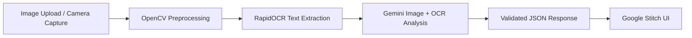

# MediScan India

An AI-assisted Flask web application that reads medicine packaging photos using **OpenCV** and **RapidOCR**, then analyzes the image and extracted text with **Google's Gemini API** alongside local Indian medicine datasets to return structured, unverified medicine identification results.

> [!CAUTION]
> **Medical Safety Disclaimer:** All outputs from MediScan India are **AI-assisted and unverified**. This tool does **not** provide dosing, medical advice, or personalised treatment recommendations. Always verify any result against the physical packaging, or consult a qualified pharmacist or doctor.

---

## Table of Contents

- [How It Works](#how-it-works)
- [Features & Safety Policy](#features--safety-policy)
- [Local Setup (Windows)](#local-setup-windows)
- [Configuration](#configuration)
- [Bundled Datasets](#bundled-datasets)
- [API Endpoints](#api-endpoints)
- [Running Tests](#running-tests)
- [Deployment (Render)](#deployment-render)
- [Project Structure](#project-structure)

---

## How It Works



1. **Image Preprocessing (OpenCV):** Applies grayscale conversion, blur denoising, Canny edge analysis, morphological operations, and contour detection to locate useful packaging regions. *Canny edge maps are used solely for region detection and are never sent as the medicine-identification input.*
2. **Text Extraction (RapidOCR):** Extracts readable text from the processed packaging image.
3. **AI Analysis (Gemini API):** Combines the packaging image and OCR output via the official `google-genai` SDK to produce a schema-validated JSON result.
4. **Privacy by Design:** All uploaded and captured images are processed strictly **in memory** and are never written to disk or stored.

---

## Features & Safety Policy

- **Evidence-Based Identification:** Requires readable packaging evidence and will not confidently identify loose, unmarked tablets.
- **No Fabricated Data:** Never fabricates MRP, prices, pack quantities, medical facts, or comparable-price rows. Any missing fields remain marked as unavailable.
- **Explicit Labelling:** All Gemini results are explicitly labelled as **AI-assisted** and **unverified**.
- **Safe Error Handling:** Missing keys, invalid credentials, unavailable models, quota exhaustion, timeouts, safety blocks, and malformed responses are mapped and reported distinctly without exposing internal provider details.
- **No Silent Paid Fallbacks:** The application strictly uses the configured model and never automatically falls back to a paid tier.

---

## Local Setup (Windows)

### 1. Create a virtual environment and install dependencies

```powershell
py -m venv .venv
.venv\Scripts\activate
pip install -r requirements.txt
pip install --no-deps rapidocr-onnxruntime==1.2.3
```

### 2. Configure environment variables

Copy the example environment file and add your Gemini API key:

```powershell
Copy-Item .env.example .env
```

Edit `.env`:

```env
GEMINI_API_KEY=your_gemini_api_key
GEMINI_MODEL=gemini-3.5-flash-lite
```

### 3. Run the application

```powershell
.venv\Scripts\python.exe app.py
```

Open [http://127.0.0.1:5000](http://127.0.0.1:5000) in your browser.

> [!NOTE]
> Browser camera capture requires a secure context (`localhost` / `127.0.0.1` or `HTTPS`).

---

## Configuration

The backend integrates with the official `google-genai` Python SDK.

| Variable | Required | Default | Description |
| :--- | :---: | :--- | :--- |
| `GEMINI_API_KEY` | Yes | — | Backend-only Gemini API key. Never expose in HTML, JS, or Git. |
| `GEMINI_MODEL` | No | `gemini-3.5-flash-lite` | Gemini model ID used for packaging analysis. |

- Model availability and free-tier quotas vary by account and region—verify your chosen model in Google AI Studio before deploying.
- `.env` is ignored by Git. Never commit real credentials to `.env.example`, `render.yaml`, source code, or Git history.

---

## Bundled Datasets

No external medicine database account or API key is required. Local CSV datasets are loaded at runtime for enrichment and comparison:

| Dataset File | Purpose |
| :--- | :--- |
| `updated_indian_medicine_data.csv` | Supplies composition, description, side effects, interactions, manufacturer, pack size, and price fields. |
| `Extensive_A_Z_medicines_dataset_of_India.csv` | Broader catalog of Indian medicines for reference and matching. |

> [!NOTE]
> Prices sourced from bundled CSVs are displayed as **unverified dataset values**, not live market prices. Missing fields remain unavailable.

---

## API Endpoints

| Method | Endpoint | Description |
| :--- | :--- | :--- |
| `POST` | `/api/identify` | Accepts a multipart `image` upload and returns the `confirmed` / `possible` identification payload or an explicit Gemini error status. |
| `GET` | `/healthz` | Reports application status, whether Gemini is configured, the active model name, and OCR package availability. |
| `GET` | `/ocr-healthz` | Initializes RapidOCR and reports OCR engine readiness. |

Health check endpoints (`/healthz` and `/ocr-healthz`) never invoke the Gemini API and never expose API keys.

---

## Running Tests

```powershell
.venv\Scripts\python.exe -m pytest -q tests
```

The test suite mocks all Gemini API calls (consuming **zero API quota**) and covers:
- Image validation and OpenCV/OCR processing behavior
- Gemini structured-response normalization and malformed-response handling
- Confirmed, possible, and unidentified medicine states
- Missing configuration, authentication, quota, and network error mapping
- Safety-compatible no-price behavior and frontend response compatibility

---

## Deployment (Render)

The repository includes a `render.yaml` blueprint that installs headless OpenCV and RapidOCR dependencies and serves the app via **Gunicorn**.

1. Connect the repository in the **Render Dashboard**.
2. Set the following environment variables in Render (do not hardcode keys in `render.yaml`):

   ```text
   GEMINI_API_KEY=<your Gemini API key>
   GEMINI_MODEL=gemini-3.5-flash-lite
   ```

3. Deploy. Render provides HTTPS automatically, enabling browser camera access out of the box.

---

## Project Structure

```text
.
├── app.py                                        # Flask routes, validation, and pipeline orchestration
├── gemini_client.py                              # Gemini SDK adapter, schema validation, and safe error mapping
├── image_processor.py                            # OpenCV preprocessing and packaging-region detection
├── ocr_service.py                                # RapidOCR extraction and text parsing
├── render.yaml                                   # Render deployment blueprint (headless OpenCV + Gunicorn)
├── .env.example                                  # Environment variable template
├── updated_indian_medicine_data.csv              # Primary enrichment & comparison dataset
├── Extensive_A_Z_medicines_dataset_of_India.csv  # Broader Indian medicines catalog
├── templates/
│   └── index.html                                # Google Stitch UI layout
├── static/
│   └── js/                                       # Upload, camera capture, loader, and result rendering
└── tests/                                        # Automated pytest suite (mocked Gemini calls)
```
